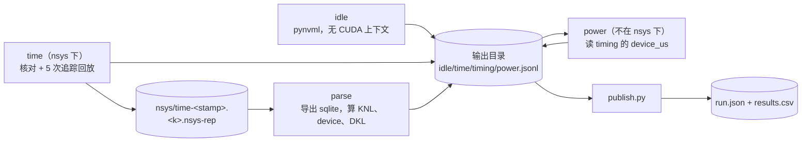

# bench：KSMM 的 GPU 计时与功率

本目录是任务 `2026-10-27-gpu-bench` 的测量工具：在一张 GPU 上测 KSMM 链的 KNL、device、DKL 时间，B1 另测稳态功率，再把结果写成 operations 数据集的一次运行。
计划见 operations 的 `tasks/2026-10-27-gpu-bench/plan.md`，口径以计划为准。

| 文件 | 作用 |
|---|---|
| `gpu_bench.py` | 测量：子命令 `idle`、`time`、`parse`、`power` |
| `run_host.sh` | 在主机上跑一个子命令：选卡、查占用、写 gpu-use-log、nvidia-smi 采样、缓存重定向；`time` 套在 nsys 里 |
| `publish.py` | 把一个输出目录写成 `run.json` 和 `results.csv`（只用标准库，在 zhang-22 上跑） |



## 用法

在 GPU 主机上（以 zhang-x4 为例；zhang-capra-xcel 换成它的 `$S`、Python 和 `/usr/local/cuda-13.2/bin/nsys`）：

```bash
export S=/scratch/users/phd/yd383/kroissant-project/scratch
export PY=/scratch/users/phd/yd383/venv-cu126/bin/python NSYS=/usr/local/cuda-12.6/bin/nsys
B=$S/ksmm-gpu-bench/bench; O=$S/gpu-bench/b1-a100-ksmm-triton; C=$S/datasets/b1/chains.csv
$B/run_host.sh 1 $O "gpu-bench idle" idle                                   # 1. 待机功率（每张卡一次）
$B/run_host.sh 1 $O "gpu-bench b1 time" time --chains $C --batch 1          # 2. 计时（nsys 下）
$PY $B/gpu_bench.py parse --out $O                                          # 3. 解析 nsys 报告（不用 GPU）
$B/run_host.sh 1 $O "gpu-bench b1 power" power --chains $C --batch 1        # 4. 功率（只 B1）
```

- `run_host.sh <物理 GPU 编号> <输出目录> "<说明>" <子命令> [参数]`。环境变量 `S`、`PY`、`NSYS` 必须设。
  - 设 `CUDA_DEVICE_ORDER=PCI_BUS_ID CUDA_VISIBLE_DEVICES=<编号>`：CUDA 的 0 号就是 nvidia-smi、NVML 的这张卡。
  - 卡上有别人的进程就退出，退出码 75。`time`、`power` 每条链开始前再查一次，`idle` 前后各查一次；查到就以 75 退出，已写的行保留。
  - 主机名是 `en-ec-zhang-x4` 时，开始、结束各往 `/scratch/users/gpu-use-log/$USER.log` 写一行。其他主机不写。
  - nvidia-smi 每 200 ms 采样，存为 `<输出目录>/smi-<子命令>-<时间>.csv`。
- `time`、`power` 的参数：`--chains <数据集>/chains.csv`（数据集名取目录名）、`--only a,b,c`、`--impl triton`、`--batch`（B1、B2 是 1，B3 是 25088）、`--n-runs`（只 `time`，默认 20）。
- 断点续测：每条链结束写一行 JSONL。重跑同一条命令，已有行的链跳过。
  - `time` 被杀掉时，nsys 仍为已结束的 cudaProfilerStart/Stop 区间生成报告（A6000 上用 `kill -9` 杀 Python 进程试过）。
  - 如果 nsys 自己也死了、报告没生成，这几条链在 `time.jsonl` 里有行、在 `timing.jsonl` 里没有。删掉 `time.jsonl` 里这几行再跑 `time`，或者用 `--only` 另开一个输出目录重测。
- 发布（在 zhang-22 上，先把输出目录 rsync 回来，可以不带 `*.nsys-rep`、`*.sqlite`）：

```bash
python3 bench/publish.py --in <输出目录的副本> --chains <ops>/datasets/b1/chains.csv \
  --run-dir <ops>/datasets/b1/runs/a100-ksmm-triton --task 2026-10-27-gpu-bench \
  --title "A100 KSMM-Triton" --nsys-bias "<T5 量到的偏差>"
```

## 口径

### 负载

- 每条链一个 CUDA graph，里面 `n_runs`（计时 20）个首尾相接的 run，run 之间不清 L2。一个 run 把整条链作用在同一个输入 X 上一次。
- fp16，BSL：X 是 (M_in, batch)，Y 是 (N_out, batch)。原始维度，不补零，第 0 级最先作用。
- 权重、输入用 `audit/a100_audit.py` 的 `Built`、`make_input`：权重 U(±√(3/C))、输入 U(±0.5)，种子是链名的 crc32。

### 计时（`time` + `parse`）

1. eager 跑一次 run（Triton 在这时 autotune），记下选中的配置。
2. 录 graph（`a100_audit.capture_graph`：旁路 stream 上先跑 3 遍，再录，录完回放 1 次）。
3. 核对 eager 输出和 graph 最后一个 run 的输出。
4. 热身回放 3 次，同步。
5. `cudaProfilerStart`，回放 5 次，每次套 NVTX 区间 `<链名>/r<k>`，同步，`cudaProfilerStop`。
6. `parse` 从 sqlite 读 kernel 的 GPU 开始、结束时间：
   - kernel 归回放：启动它的 API 调用（graph 节点是那次回放的 `cudaGraphLaunch`，`correlationId` 相同）在 NVTX 区间里、同一线程。NVTX 区间是主机时间，在 kernel 执行前就结束，所以只用它找 `cudaGraphLaunch`，不按 GPU 时间圈 kernel。
   - kernel 的先后按 `graphNodeId`：录 graph 时按发射顺序分配，A6000 上实测是连续的 0、1、2……。相邻 kernel 的 GPU 时间戳可能重叠几十到两百 ns，按开始时间排不可靠。`start_inversions` 记按开始时间排会颠倒的对数，`overlaps` 记后一个开始早于前一个结束的对数。
   - 一次回放的 kernel 数必须等于 `n_runs × 级数`，否则这次回放不算，写进 `problems`。按顺序每 `级数` 个切成一个 run。
   - KNL = 一个 run 各 kernel 的 (end − start) 之和；device = 本 run 最后一个 kernel 的 end − 上一个 run 最后一个 kernel 的 end，每次回放的第 1 个 run 不算 device；DKL = 每个 run 的 device − KNL 取中位数。
   - 报中位数、p20、p80（线性插值，`a100_audit.quantiles`）。样本：KNL 100 个，device 95 个。`knl_gt_device` 记 KNL > device 的 run 数。

### 功率（`idle`、`power`）

- `idle`：只 import pynvml，不 import torch，不建 CUDA 上下文。卡号取 `CUDA_VISIBLE_DEVICES`（物理编号）。
- `power`：
  - 读本目录 `timing.jsonl` 里这条链的 `device_us`，所以先 `time`、`parse`，再 `power`。
  - graph 从 20 个 run 起，不开追踪试跑 5 s，`busy_pct` < 95% 就翻倍重录，最多 20480，记 `power_n_runs` 和每次试跑的 `trials`。
  - 选定后回放 120 s。主机最多领先 8 次回放：提交第 i 次前等第 i−8 次回放后记的 event。
- 两者共用：
  - 第 30 s、第 90 s 各读一次 `nvmlDeviceGetTotalEnergyConsumption`，功率 = 能量差 ÷ 两次读数之间的实际时长（约 60 s，`window_s` 记实际值）。
  - 另一个线程每 100 ms 采功率、SM 时钟、温度、降频原因，存为 `power-samples/<链名>.csv`（待机是 `idle-<时间>.csv`）。
  - `power_spread_pct`：窗口里的采样按 5 s 分 12 段，各段平均的（最大 − 最小）÷ 平均。`sm_mhz` 是窗口里的中位数，`temp_c` 是最大值，`clock_event_reasons` 是各采样降频原因位的或。
- `power` 的窗口用两个 CUDA event 标出：`window_runs` = 两个 event 之间提交的回放数 × `power_n_runs`。
  - `busy_pct` = `window_runs` × `device_us` ÷ 两个 event 之间的 GPU 时间。
  - `e_run_uj` = (`p_work_w` − `p_idle_w`) × `window_s` ÷ `window_runs`，由 `publish.py` 算。`p_idle_w` 取同一 UUID 的卡最近一次 `idle`。
- 功率阶段不在 nsys 下：`run_host.sh` 只给 `time` 套 nsys。

### 核对

- 和 fp32 参考比相对 L2 误差。eager 和 graph 最后一个 run 都 ≤ 1e-2 且有限，`check` 记「通过」，否则「失败」。出异常也记「失败」，原因写在 `error`。
- 参考：B1 用 `Built` 的各级稠密矩阵 fp32 连乘；其他数据集用 `Built.stagewise32`（fp32 einsum 逐级算）。按数据集名判断，见 `DENSE_REFERENCE`。

## nsys 会话的组织

- 一次 `time` 命令只起一个 nsys 进程，覆盖这次要测的全部链。几百条链不用起几百次 nsys。
- `--capture-range=cudaProfilerApi --capture-range-end=repeat`：每条链的 5 次回放是一个 `cudaProfilerStart/Stop` 区间，区间之外的工作不追踪，包括 autotune、参考计算、核对、录 graph 和热身。
- 每个区间生成一个报告 `nsys/time-<启动时间>.<k>.nsys-rep`，k 从 1 起。报告在 nsys 结束时统一生成，Python 被杀时也会生成。
- `parse` 按（启动时间，k）的顺序处理还没解析过的报告：先导出同名 `.sqlite`，再按 NVTX 标签里的链名对上 `time.jsonl` 的行。同一条链有几行时，`publish.py` 取最后一行。
- 选这种方式的理由：每条链一个 nsys 进程，就要多启动几百次 nsys 和 Python，每次都重新导入 torch、加载 Triton；整批一个区间又会追踪到区间外的工作，违背「只追踪这 5 次回放」。

## 输出格式

都在 `--out` 目录里。每个进程开头写一行 `kind: provenance`：主机、GPU 型号、物理编号、UUID、PCI、`CUDA_VISIBLE_DEVICES`、驱动、Python、torch、CUDA 运行时、triton、nsys 版本、ksmm 提交和工作区是否干净、开始时的负载和卡上的进程、时钟。

| 文件 | 每行 | 主要字段 |
|---|---|---|
| `time.jsonl` | 一条链（`kind: point`） | `chain`、`impl`、`batch`、`stages`、`n_runs`、`config`、`eager_rel_l2`、`graph_rel_l2`、`rel_l2`、`check`、`error`、`gpu_uuid` |
| `timing.jsonl` | 一条链一个报告（`kind: timing`） | `knl_us`、`knl_p20/p80`、`device_us`、`device_p20/p80`、`dkl_us`、`kernels`、`knl_n`、`device_n`、`knl_gt_device`、`overlaps`、`start_inversions`、`grids`、`problems`、`report` |
| `power.jsonl` | 一条链（`kind: point`） | `power_n_runs`、`trials`、`p_work_w`、`window_s`、`window_runs`、`window_gpu_s`、`busy_pct`、`power_spread_pct`、`sm_mhz`、`temp_c`、`clock_event_reasons`、`samples_file` |
| `idle.jsonl` | 一次待机（`kind: idle`） | `gpu_uuid`、`p_idle_w`、`window_s`、`power_spread_pct`、`samples_file` |

`publish.py` 写出的 `results.csv` 列照计划：`chain`、`check`、`knl_us`、`knl_p20`、`knl_p80`、`device_us`、`device_p20`、`device_p80`、`dkl_us`、`kernels`、`rel_l2`；有 `power.jsonl` 时再加 `p_idle_w`、`p_work_w`、`p_useful_w`、`e_run_uj`、`power_n_runs`、`busy_pct`、`power_spread_pct`、`sm_mhz`、`temp_c`；最后是 `note`。每列的说明写在 `run.json` 的 `columns`。

## 怎样接入新实现

一个实现是一个函数 `make(torch, built, x) -> Impl`，登记在 `gpu_bench.py` 的 `IMPLS` 里：

```python
class Impl(NamedTuple):
    run: Callable[[], object]   # 跑一次 run：整条链作用在 x 上一次，返回 (N_out, batch) 的 fp16 张量
    config: Callable[[], str]   # 实际用的 kernel 配置；第一次 eager run 之后调用

def make_cuda(torch, built, x) -> Impl:
    # built.chain.stages：[(A, B, C, D), ...]，第 0 级最先作用
    # built.w4[k]：第 k 级权重，fp16，形状 (A, B, C, D)；built.k_bmm[k]：同一份权重排成 (A·D, C, B)
    # x：(M_in, batch) fp16，batch = x.shape[1]
    ...  # 准备权重布局、选超参、编译或加载扩展
    def run():
        ...  # 在当前 CUDA stream 上逐级启动 kernel，录 graph 时才录得进去
        return y
    return Impl(run, lambda: "<超参>")

IMPLS = {"triton": make_triton, "cuda": make_cuda}
```

- `run` 里不要同步、不要在主机上读 GPU 数据：它会被录进 graph。
- 超参缺失、跑不了时在 `make` 里抛异常，这条链记「失败」并写 `error`。计划要求记「未运行」的情况（B3 的 cuda 没有超参的 56 条），用 `--only` 不跑它们，`publish.py` 自动记「未运行」，`note` 由发布者补写。
- 在 `publish.py` 的 `IMPL_TEXT` 里加一句实现说明，写进 `run.json` 的 `config.impl`。
- 命令行：`--impl cuda`。

## 已知现象

- 相邻 kernel 的 nsys 时间戳会重叠：A6000 上长 kernel（约 45 µs）之间重叠中位数 96 ns、最多 224 ns，这时 KNL 比 device 大约 0.1–0.2 µs，DKL 为负。短 kernel 之间是 32–96 ns 的空隙。`knl_gt_device`、`overlaps` 记下了每条链的情况，`publish.py` 写进 `note`。
- `busy_pct` 用的 `device_us` 来自 nsys 追踪，比不追踪时长：A6000 上 `debut_butterfly16` 追踪下 device 5.28 µs，不追踪的功率窗口里平均每个 run 4.20 µs，`busy_pct` 算出 125%。
