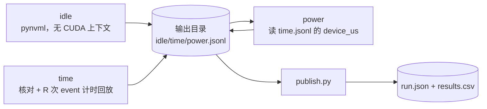
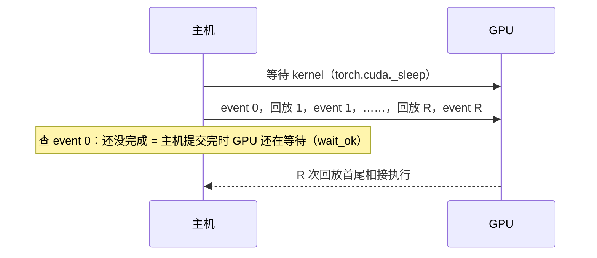
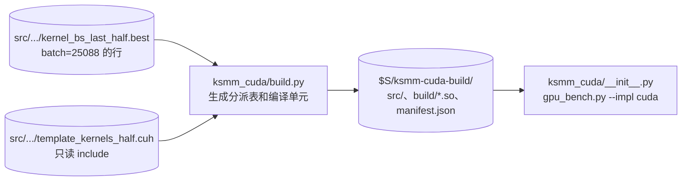

# bench：KSMM 的 GPU 计时与功率

本目录是任务 `2026-10-27-gpu-bench` 的测量工具：在一张 GPU 上测 KSMM 链的 device 时间，B1 另测稳态功率，再把结果写成 operations 数据集的一次运行。
计划见 operations 的 `tasks/2026-10-27-gpu-bench/plan.md`，口径以计划为准。计时不追踪，不用 nsys、ncu（计划的决策 D7）。

| 文件 | 作用 |
|---|---|
| `gpu_bench.py` | 测量：子命令 `idle`、`time`、`power` |
| `run_host.sh` | 在主机上跑一个子命令：选卡、查占用、写 gpu-use-log、nvidia-smi 采样、缓存重定向 |
| `publish.py` | 把一个输出目录写成 `run.json` 和 `results.csv`（只用标准库，在 zhang-22 上跑） |
| `ksmm_cuda/` | 实现 `cuda`：`build.py` 生成并编译 ksmm-cuda 的 torch 扩展，`__init__.py` 加载它，见「ksmm-cuda」 |



## 用法

在 GPU 主机上（以 zhang-x4 为例；zhang-capra-xcel 换成它的 `$S` 和 Python）：

```bash
export S=/scratch/users/phd/yd383/kroissant-project/scratch
export PY=/scratch/users/phd/yd383/venv-cu126/bin/python
B=$S/ksmm-gpu-bench/bench; O=$S/gpu-bench/b1-a100-ksmm-triton; C=$S/datasets/b1/chains.csv
$B/run_host.sh 1 $O "gpu-bench idle" idle                                   # 1. 待机功率（每张卡一次）
$B/run_host.sh 1 $O "gpu-bench b1 time" time --chains $C --batch 1          # 2. 计时
$B/run_host.sh 1 $O "gpu-bench b1 power" power --chains $C --batch 1        # 3. 功率（只 B1，要先有计时）
```

- `run_host.sh <物理 GPU 编号> <输出目录> "<说明>" <子命令> [参数]`。环境变量 `S`、`PY` 必须设。
  - 设 `CUDA_DEVICE_ORDER=PCI_BUS_ID CUDA_VISIBLE_DEVICES=<编号>`：CUDA 的 0 号就是 nvidia-smi、NVML 的这张卡。
  - 卡上有别人的进程就退出，退出码 75。`time`、`power` 每条链开始前再查一次，`idle` 前后各查一次；查到就以 75 退出，已写的行保留。
  - 主机名是 `en-ec-zhang-x4` 时，开始、结束各往 `/scratch/users/gpu-use-log/$USER.log` 写一行。其他主机不写。
  - nvidia-smi 每 200 ms 采样，存为 `<输出目录>/smi-<子命令>-<时间>.csv`。
- `time`、`power` 的参数：`--chains <数据集>/chains.csv`（数据集名取目录名）、`--only a,b,c`、`--impl triton` 或 `cuda`、`--batch`（B1、B2 是 1，B3 是 25088）、`--n-runs`（只 `time`，默认 20）。
- 断点续测：每条链结束写一行 JSONL。重跑同一条命令，已有行的链跳过。
- 发布（在 zhang-22 上，先把输出目录 rsync 回来）：

```bash
python3 bench/publish.py --in <输出目录的副本> --chains <ops>/datasets/b1/chains.csv \
  --run-dir <ops>/datasets/b1/runs/a100-ksmm-triton --task 2026-10-27-gpu-bench --title "A100 KSMM-Triton"
```

## 口径

### 负载

- 每条链一个 CUDA graph，里面 `n_runs`（20）个首尾相接的 run，run 之间不清 L2。一个 run 把整条链作用在同一个输入 X 上一次。
- fp16，BSL：X 是 (M_in, batch)，Y 是 (N_out, batch)。原始维度，不补零，第 0 级最先作用。
- 权重、输入用 `audit/a100_audit.py` 的 `Built`、`make_input`：权重 U(±√(3/C))、输入 U(±0.5)，种子是链名的 crc32。

### 计时（`time`）



1. eager 跑一次 run（Triton 在这时 autotune），记下选中的配置。
2. 录 graph（`a100_audit.capture_graph`：旁路 stream 上先跑 3 遍，再录，录完回放 1 次）。
3. 核对 eager 输出和 graph 最后一个 run 的输出。
4. 热身：像功率阶段那样连续回放 W = `WARMUP_S`（0.5 s，标定见下）秒，主机最多领先 8 次回放，让 GPU 升到稳定频率。热身期间平均每次回放的 GPU 时间记为 `warmup_replay_ms`，它决定 R：不超过 10 ms 时 R = 100；超过时 R = 1000 ms ÷ 它（四舍五入），不少于 10。
5. 往流上放一个等待 kernel（`torch.cuda._sleep`，从 1 亿个周期起），记 event 0，再交替提交 R 次回放和 R 个 event。
6. 提交完以后查 event 0：还没完成，说明等待 kernel 还在跑，R 次回放在 GPU 上首尾相接，`wait_ok` = true。已经完成就把等待加倍重测，最多 6 次；仍不行就记 `wait_ok` = false，`publish.py` 写进 `note`。
7. 第 i 次回放的 device 时间 = (event i − event i−1) ÷ 20。报 R 个值的中位数 `device_us` 和 p20、p80（线性插值，`a100_audit.quantiles`）。device 时间包含各级的 DKL 和 KNL，以及摊到每个 run 的 1/20 次 graph 启动。

### 热身时长 W 的标定

- 规则（计划「计时」第 1 点）：取能让 `device_us` 和热身 3 s 时相差不超过 1% 的最短 W，不是 0.5 s 的整数倍就向上取。
- 做法：A6000（zhang-capra-xcel GPU0），2026-10-27 22:33–22:36 EDT。每条链录一次 graph。依次测 3 轮，每轮按 W = 0.25、0.5、1、2、3 s 各测 1 次。每次测之前主机空等 5 s，让 GPU 空闲；然后 `warm_up(W)`，再 `timed_replays(100)` 取中位数。
- 结果（µs，3 次的值和平均；差值是平均对 W = 3 s 的平均）：

| W（s） | debut_butterfly16 | 差值 | butterfly_8192 | 差值 |
|---|---|---|---|---|
| 0.25 | 4.250、4.301、4.301（4.284） | −0.4% | 60.032、58.982、59.802（59.605） | +0.3% |
| 0.5 | 4.250、4.301、4.301（4.284） | −0.4% | 59.494、58.854、59.315（59.221） | −0.4% |
| 1 | 4.250、4.301、4.301（4.284） | −0.4% | 60.109、59.315、59.341（59.588） | +0.3% |
| 2 | 4.301、4.301、4.301（4.301） | 0.0% | 59.546、59.853、59.546（59.648） | +0.4% |
| 3 | 4.301、4.301、4.301（4.301） | — | 59.648、59.341、59.315（59.435） | — |

- W = 0.25 s 已满足 1%，向上取到 0.5 s 的整数倍，默认 W = 0.5 s。W = 0.5 s 时单次值和 W = 3 s 平均的偏差最大是 −0.98%（butterfly_8192 的 58.854 对 59.435）。
- 作为对照：同一条 `debut_butterfly16` 只热身 3 次回放时是 4.608 µs，即 commit b886d5d 的测试。
- 探针脚本没有提交，命令和输出写在 T3 的报告里。

### 功率（`idle`、`power`）

- `idle`：只 import pynvml，不 import torch，不建 CUDA 上下文。卡号取 `CUDA_VISIBLE_DEVICES`（物理编号）。
- `power`：
  - 读本目录 `time.jsonl` 里这条链的 `device_us`，所以先 `time`，再 `power`。
  - graph 从 20 个 run 起，试跑 5 s，`busy_pct` < 95% 就翻倍重录，最多 20480，记 `power_n_runs` 和每次试跑的 `trials`。
  - 选定后回放 120 s。主机最多领先 8 次回放：提交第 i 次前等第 i−8 次回放后记的 event。
- 两者共用：
  - 第 30 s、第 90 s 各读一次 `nvmlDeviceGetTotalEnergyConsumption`，功率 = 能量差 ÷ 两次读数之间的实际时长（约 60 s，`window_s` 记实际值）。
  - 另一个线程每 100 ms 采功率、SM 时钟、温度、降频原因，存为 `power-samples/<链名>.csv`（待机是 `idle-<时间>.csv`）。
  - `power_spread_pct`：窗口里的采样按 5 s 分 12 段，各段平均的（最大 − 最小）÷ 平均。`sm_mhz` 是窗口里的中位数，`temp_c` 是最大值，`clock_event_reasons` 是各采样降频原因位的或。
- `power` 的窗口用两个 CUDA event 标出：`window_runs` = 两个 event 之间提交的回放数 × `power_n_runs`。
  - `busy_pct` = `window_runs` × `device_us` ÷ 两个 event 之间的 GPU 时间。可能略超过 100%，见「已知现象」。
  - `e_run_uj` = (`p_work_w` − `p_idle_w`) × `window_s` ÷ `window_runs`，由 `publish.py` 算。`p_idle_w` 取同一 UUID 的卡最近一次 `idle`。

### 核对

- 和 fp32 参考比相对 L2 误差。eager 和 graph 最后一个 run 都 ≤ 1e-2 且有限，`check` 记「通过」，否则「失败」。出异常也记「失败」，原因写在 `error`。
- 参考：B1 用 `Built` 的各级稠密矩阵 fp32 连乘；其他数据集用 `Built.stagewise32`（fp32 einsum 逐级算）。按数据集名判断，见 `DENSE_REFERENCE`。

## 输出格式

都在 `--out` 目录里。每个进程开头写一行 `kind: provenance`：主机、GPU 型号、物理编号、UUID、PCI、`CUDA_VISIBLE_DEVICES`、驱动、Python、torch、CUDA 运行时、triton 的版本、ksmm 提交和工作区是否干净、开始时的负载和卡上的进程、时钟。

| 文件 | 每行 | 主要字段 |
|---|---|---|
| `time.jsonl` | 一条链（`kind: point`） | `chain`、`impl`、`batch`、`stages`、`n_runs`、`config`、`eager_rel_l2`、`graph_rel_l2`、`rel_l2`、`check`、`device_us`、`device_p20`、`device_p80`、`replays`、`replay_ms`（R 个值）、`warmup_replay_ms`、`wait_ok`、`wait_cycles`、`wait_tries`、`host_submit_ms`、`error`、`gpu_uuid` |
| `power.jsonl` | 一条链（`kind: point`） | `power_n_runs`、`trials`、`device_us`、`p_work_w`、`window_s`、`window_runs`、`window_gpu_s`、`busy_pct`、`power_spread_pct`、`sm_mhz`、`temp_c`、`clock_event_reasons`、`samples_file` |
| `idle.jsonl` | 一次待机（`kind: idle`） | `gpu_uuid`、`p_idle_w`、`window_s`、`power_spread_pct`、`samples_file` |

`publish.py` 写出的 `results.csv` 列照计划：`chain`、`check`、`device_us`、`device_p20`、`device_p80`、`replays`、`rel_l2`；有 `power.jsonl` 时再加 `p_idle_w`、`p_work_w`、`p_useful_w`、`e_run_uj`、`power_n_runs`、`busy_pct`、`power_spread_pct`、`sm_mhz`、`temp_c`；最后是 `note`。每列的说明写在 `run.json` 的 `columns`。

## 怎样接入新实现

一个实现是一个函数 `make(torch, built, x) -> Impl`，登记在 `gpu_bench.py` 的 `IMPLS` 里：

```python
class Impl(NamedTuple):
    run: Callable[[], object]   # 跑一次 run：整条链作用在 x 上一次，返回 (N_out, batch) 的 fp16 张量
    config: Callable[[], str]   # 实际用的 kernel 配置；第一次 eager run 之后调用

def make_cuda(torch, built, x) -> Impl:
    # built.chain.stages：[(A, B, C, D), ...]，第 0 级最先作用
    # built.w4[k]：第 k 级权重，fp16，形状 (A, B, C, D)；built.k_bmm[k]：同一份权重排成 (A·D, C, B)
    # x：(M_in, batch) fp16，batch = x.shape[1]
    ...  # 准备权重布局、选超参、编译或加载扩展
    def run():
        ...  # 在当前 CUDA stream 上逐级启动 kernel，录 graph 时才录得进去
        return y
    return Impl(run, lambda: "<超参>")

IMPLS = {"triton": make_triton, "cuda": make_cuda}
```

- `run` 里不要同步、不要在主机上读 GPU 数据：它会被录进 graph。
- 超参缺失、跑不了时在 `make` 里抛异常，这条链记「失败」并写 `error`。计划要求记「未运行」的情况（B3 的 cuda 没有超参的 56 条），用 `--only` 不跑它们，`publish.py` 自动记「未运行」，`note` 由发布者补写。
- 在 `publish.py` 的 `IMPL_TEXT` 里加一句实现说明，写进 `run.json` 的 `config.impl`。
- 命令行：`--impl cuda`。

## ksmm-cuda（`--impl cuda`）

ksmm 自带的 CUDA kernel，只用于 B3：fp16，batch 在后（bs_last，即 BSL），batch = 25088，A6000（sm_86）。



- **超参**：只取 `kernel_bs_last_half.best` 里 batch = 25088 的行（第 1 列是 batch，第 2–5 列是 a、b、c、d，第 6–11 列是 TILEX、TILEK、TILEY、TX、TY、VSIZE）。没有超参的 pattern 不跑，不用 `kernel.py` 的回退搜索（它不看 batch，`kernel.py:171-173`）。
  - 表里 batch = 25088 有 687 行、675 个不同的 pattern。重复的行完全相同，`build.py` 遇到不同的重复行就报错。
  - VSIZE 照表取（2 或 4），模板实例的写法照 `kernel.py:28-35`：VSIZE 4 用 `kernel_bs_last_half4<bool, …, false, TILEX/TX>`，VSIZE 2 用 `kernel_bs_last_half2<half2, …, true, TILEX/TX>`。
- **不改 `src/`**：`kernel.py:247-284` 会改写受追踪的 `.cuh`，所以不调用它。`build.py` 只读 `template_kernels_half.cuh`（用 `-I` include），自己生成分派表。
- **编译单元**：模板参数只有 (TILEX, TILEK, TILEY, TX, TY, VSIZE)，a、b、c、d 是运行时参数。所以按参数组合拆编译单元：675 个 pattern 只用到 50 种组合，生成 50 个 `cfgNN.cu`，加一个 `binding.cpp`（pattern → 启动函数的表）。
- **stream**：每个 kernel 用 `<<<grid, block, 0, c10::cuda::getCurrentCUDAStream()>>>` 启动（`at::cuda::getCurrentCUDAStream` 就是这个函数），所以能录进 graph。输出用 `torch::empty` 从缓存分配器分配。
- **检查**：扩展只接受表里的 pattern、fp16、连续、x 形状 (a·c·d, 25088)；其他情况抛异常，这条链记「失败」。
- **权重**：`built.k_bmm[k]`（形状 (A·D, C, B)）按 (A·D·C, B) 传入，和 `interface.py:69` 的 kernel 格式相同。
- **精度**：kernel 用 fp16 累加（`template_kernels_half.cuh` 的 `__hadd(tmp_acc, __hmul(...))`），核对可能失败。失败照实记。

### 生成和编译（在 zhang-capra-xcel 上）

```bash
export S=/work/zhang-capra/users/yd383/kroissant-project/scratch
export TRITON_CACHE_DIR=$S/.triton XDG_CACHE_HOME=$S/.cache TMPDIR=$S/tmp PYTHONDONTWRITEBYTECODE=1
export CUDA_HOME=/usr/local/cuda-12.1 CUDA_VISIBLE_DEVICES=""   # nvcc 的选择见 env.md「T4 · ksmm-cuda 的编译工具链」；编译不用 GPU
mkdir -p $S/ksmm-cuda-build
$S/venv-cu126/bin/python <ksmm>/bench/ksmm_cuda/build.py --out $S/ksmm-cuda-build --jobs 8 > $S/ksmm-cuda-build/build.log 2>&1
```

- 输出：`$S/ksmm-cuda-build/src/`（生成的源文件）、`build/ksmm_cuda_bsl_half.so`（ninja 构建，`torch.utils.cpp_extension.load`）、`manifest.json`（pattern 数、组合数、编译目标 `sm_86`、`.best`、模板和 `.so` 的 sha256、nvcc 和 torch 版本、用时）。
- `TORCH_CUDA_ARCH_LIST=8.6` 由 `build.py` 设置，只生成 `sm_86`。并行度 `--jobs`（即 `MAX_JOBS`）默认 8：机器有 48 核，别人也在用，8 个已经够快。
- 用时（2026-10-27 23:07 EDT 清空后重编，`--jobs 8`，负载约 2.3–2.8）：`build_s` 17.4 s，`/usr/bin/time` 的 wall 19.22 s（22:51 EDT 的第一次全量编译是 17.3 s）。每个 `cfgNN.cu` 约 1.6–2.8 s，`binding.cpp`（含 torch 头文件）16.9 s，是关键路径。
- 估算（同一天 22:50 EDT）：先用 `--limit 10`（前 10 个 pattern，2 种组合）编到另一个目录，用了 17.0 s。按组合算全量约 50 × 1.6 s ÷ 8 + 17 s，远低于 8 小时。
- `--limit N` 只用于估算，正式构建不用。

### 运行

```bash
export S=/work/zhang-capra/users/yd383/kroissant-project/scratch PY=$S/venv-cu126/bin/python
B=$S/ksmm-gpu-bench/bench; C=$S/datasets/b3/chains.csv
ONLY=$($PY $B/ksmm_cuda/build.py --covered $C)    # 有超参的链名，逗号分隔；stderr 打印「672 chains covered」
$B/run_host.sh <卡号> $S/gpu-bench/b3-a6000-ksmm-cuda "gpu-bench b3 cuda" time --impl cuda --chains $C --only "$ONLY" --batch 25088
```

- 扩展从 `$KSMM_CUDA_BUILD/build/ksmm_cuda_bsl_half.so` 加载，没设 `KSMM_CUDA_BUILD` 时用 `$S/ksmm-cuda-build`。运行时不需要 nvcc。
- 溯源：`time.jsonl` 的 provenance 行多一个 `cuda_build`，就是同一构建目录的 `manifest.json`。读它时核对 `.so` 的 sha256，和 manifest 不符就报错（要重编）。`publish.py` 把它写进 `run.json` 的 `config.cuda_build`。
- `--covered` 只用标准库，也能在 zhang-22 上用 `python3` 跑。B3 的 728 条里 672 条有超参；其余 56 条不跑，`publish.py` 记「未运行」，`note` 由发布者补写「没有 batch=25088 的 fp16 bs_last 超参」。
- `config` 字段是每级的超参：`TILEX×TILEK×TILEY/tTX×TY/vVSIZE`，例如 `16x16x128/t8x4/v4`。

## 已知现象

在 A6000（zhang-capra-xcel GPU0）上看到的现象：

- 每次回放之间记带计时的 event，每次回放长约 2 µs。`debut_butterfly16` 上，平均每个 run 是 4.587 µs；只在两头记 event 时是 4.476 µs，相差约 0.11 µs/run。计划要求逐次回放记 event，这个偏差照实留在 `device_us` 里，`run.json` 的 `config.timing` 写明。
- 不锁频。只热身 3 次回放时，短链的 `device_us` 随 GPU 是否已经升频而变（`debut_butterfly16` 是 4.608 µs 对 4.352 µs），所以热身改为连续回放 W 秒，W 的标定见上一节。
- W = 0.5 s 时的重复性（提交 294e01e，A6000）：同一进程先测 `debut_butterfly16`，再测 B1 的其余 65 条链，最后再测一次 `debut_butterfly16`，两次隔 4 分 16 秒，结果 4.326 µs 对 4.352 µs，相差 +0.6%。
- `busy_pct` 可能略超过 100%。一部分原因是 `device_us` 含计时 event 的开销（约 0.11 µs/run），功率窗口里记的是不计时的 event。短功率测试中（20 s，窗口 5–15 s）：
  - `debut_butterfly16`：`device_us` 4.352 µs，窗口里平均每个 run 4.183 µs，`busy_pct` 104.0%。
  - `butterfly_8192`：`device_us` 59.955 µs，窗口里平均每个 run 59.925 µs，`busy_pct` 100.05%。
